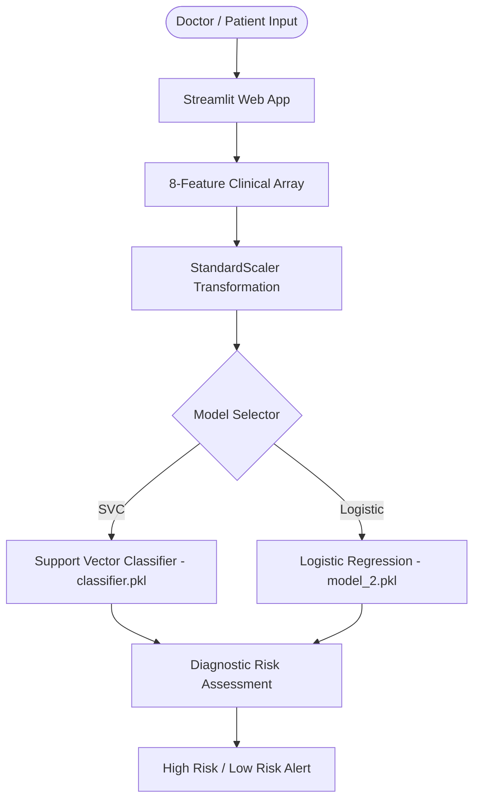

# 🩺 Diabetes Diagnostic Prediction Web App

[](https://bstappwbpsicamygt9672um.streamlit.app/)
[](https://github.com/sounakthakur9045-creator/diabetes-prediction-app)

> 🌐 **Live Web Application**: [bstappwbpsicamygt9672um.streamlit.app](https://bstappwbpsicamygt9672um.streamlit.app/)

An end-to-end interactive Machine Learning diagnostic tool built with **Streamlit** and **Scikit-Learn** that predicts diabetes risk (High Risk vs. Low Risk/Negative) based on 8 clinical health metrics.

---

## 🌟 Key Features

- **Dual-Model Inference**: Allows doctors and users to dynamically toggle between a **Support Vector Classifier (SVC)** and **Logistic Regression** for comparative risk evaluation.
- **Dynamic Feature Scaling**: Automatically normalizes clinical inputs using a serialized `StandardScaler` to maintain model fidelity and prevent feature dominance.
- **Interactive Web Interface**: Clean, dual-column responsive Streamlit UI optimized for real-time patient metric input.
- **High-Performance Caching**: Fast model and scaler deserialization using Streamlit's `@st.cache_resource`.

---

## 🔬 Clinical Parameters Used

| Metric | Description | Normal / Baseline Range |
| :--- | :--- | :--- |
| **Pregnancies** | Number of times pregnant | 0 – 20 |
| **Glucose Level** | Plasma glucose concentration (2 hours in OGTT) | 70 – 140 mg/dL |
| **Blood Pressure** | Diastolic blood pressure | 60 – 90 mm Hg |
| **Skin Thickness** | Triceps skin fold thickness | 10 – 50 mm |
| **Insulin Level** | 2-Hour serum insulin | 15 – 276 mu U/ml |
| **BMI** | Body mass index (weight in kg / (height in m)²) | 18.5 – 24.9 |
| **Diabetes Pedigree Function** | Genetic diabetes score based on family history | 0.08 – 2.42 |
| **Age** | Patient age in years | 1 – 120 years |

---

## 🏗️ Architecture



---

## 📂 Project Structure

```
├── app.py              # Interactive Streamlit diagnostic application
├── classifier.pkl      # Serialized Support Vector Classifier (SVC)
├── model_2.pkl         # Serialized Logistic Regression Model
├── scaler.pkl          # Serialized StandardScaler
└── requirements.txt    # Python dependencies
```

---

## 🚀 Quickstart

### 1. Clone the Repository
```bash
git clone https://github.com/sounakthakur9045-creator/diabetes-prediction-app.git
cd diabetes-prediction-app
```

### 2. Set Up Environment & Install Dependencies
```bash
python -m venv .venv

# On Windows:
.venv\Scripts\activate

# On macOS/Linux:
source .venv/bin/activate

pip install -r requirements.txt
```

### 3. Run the Diagnostic App
```bash
streamlit run app.py
```
Open your browser at `http://localhost:8501`.
